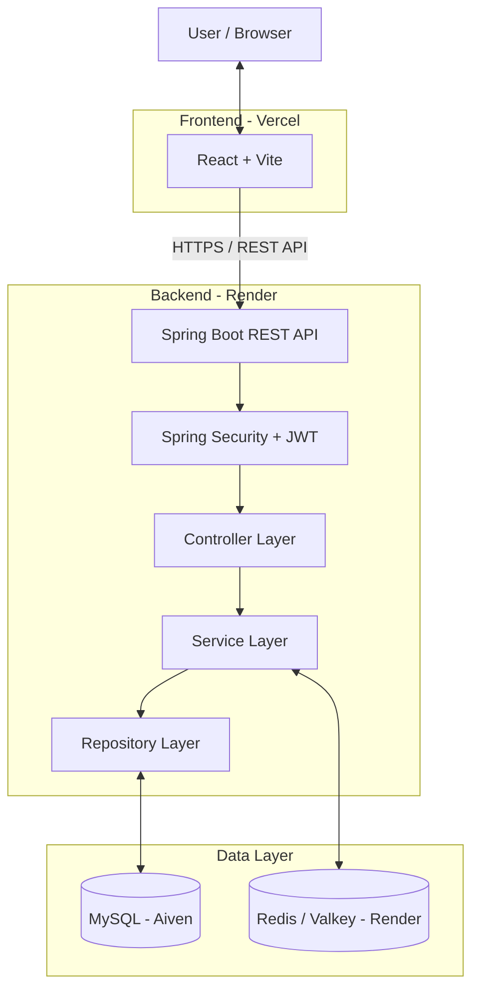

<div align="center">

# 🔗 URL Shortener

### Turn long links into short, shareable URLs.

A full-stack URL shortener built with Java, Spring Boot, React, MySQL, and Redis-compatible Valkey.

[Features](#-features) • [Architecture](#️-architecture) • [Tech Stack](#️-tech-stack) • [Run Locally](#-run-locally) • [API](#-api-overview)

</div>

---

## ✨ Features

- **Short URL Generation** — Convert long URLs into compact, shareable links.
- **Custom Aliases** — Choose memorable aliases instead of randomly generated codes.
- **JWT Authentication** — Secure user registration, login, and protected endpoints.
- **URL Management** — View, manage, and delete your shortened URLs.
- **Click Analytics** — Track the usage of shortened links.
- **URL Expiration** — Configure links to expire after a specified period.
- **Redis/Valkey Caching** — Cache URL mappings to reduce repeated database lookups.
- **Rate Limiting** — Limit repeated requests to help prevent API abuse.
- **Input Validation** — Validate incoming requests and handle invalid input.
- **Centralized Exception Handling** — Return consistent API errors.
- **Docker Support** — Containerize the Spring Boot application for deployment.

> **Note:** A custom domain has not been configured yet, so generated short links currently use the deployed service URL.

## 🖼️ Screenshots

Add screenshots of your running application to the `frontend/images/` directory.

Suggested screenshots:

| Login | Dashboard |
|---|---|
| `images/login.png` | `images/dashboard.png` |

| Create Short URL | Analytics |
|---|---|
| `images/create-url.png` | `images/analytics.png` |

Once the screenshots are available, embed them here:

```html
<p align="center">
  
  
</p>
<p align="center">
  
  
</p>
```

## 🛠️ Tech Stack

| Layer | Technology |
|---|---|
| Language | Java |
| Backend Framework | Spring Boot |
| REST API | Spring Web |
| Persistence | Spring Data JPA, Hibernate |
| Database | MySQL |
| Authentication | Spring Security, JWT |
| Caching | Redis-compatible Valkey |
| Frontend | React, Vite |
| HTTP Client | Axios |
| Containerization | Docker |
| Backend Hosting | Render |
| Frontend Hosting | Vercel |
| Database Hosting | Aiven |

## 🏗️ Architecture



### Request Flow

#### 1. Create a Short URL

1. The frontend sends a long URL and an optional custom alias to the backend.
2. Spring Security checks authentication for protected endpoints.
3. The controller receives and validates the request.
4. The service generates a short code or processes the requested alias.
5. The repository persists the URL mapping in MySQL.
6. The API returns the shortened URL to the frontend.

#### 2. Redirect to the Original URL

1. A browser requests `/{shortCode}`.
2. The backend checks Redis/Valkey for the URL mapping.
3. On a cache miss, the application retrieves the mapping from MySQL.
4. The mapping may be cached for subsequent requests.
5. The backend returns an HTTP redirect to the original URL.

#### 3. Authentication

1. A user registers or logs in.
2. The backend validates the credentials.
3. After successful authentication, the application issues a JWT.
4. The frontend sends the token in the `Authorization` header for protected requests.
5. Spring Security validates the token before allowing access.

## 🚀 Run Locally

### Prerequisites

Install the following:

- Java 17 or the version configured in the project
- Maven, or use the included Maven Wrapper
- Node.js and npm
- MySQL
- Redis/Valkey
- Docker (optional)

### 1. Clone the Repository

```bash
git clone https://github.com/Basavaraj8143/url-shortener.git
cd url-shortener
```

### 2. Configure MySQL

Create the database:

```sql
CREATE DATABASE url_shortener;
```

### 3. Configure the Backend

Configure the environment variables supported by your application.

Example local configuration:

```properties
DB_HOST=localhost
DB_PORT=3306
DB_NAME=url_shortener
DB_USERNAME=root
DB_PASSWORD=your_local_password

JWT_SECRET=replace_with_a_long_random_secret

REDIS_HOST=localhost
REDIS_PORT=6379

CORS_ALLOWED_ORIGINS=http://localhost:5173
```

These are environment-variable examples, not literal Java properties. Set them in your IDE's run configuration or your local environment.

**Never commit real passwords, production credentials, or JWT secrets.**

Start the backend from the directory containing `pom.xml`.

Using the Maven Wrapper on Windows:

```powershell
.\mvnw.cmd spring-boot:run
```

On macOS/Linux:

```bash
./mvnw spring-boot:run
```

Alternatively, if Maven is installed:

```bash
mvn spring-boot:run
```

The backend normally runs at:

`http://localhost:8080`

### 4. Configure the Frontend

Open a terminal:

```bash
cd frontend
npm install
```

Create a `.env` file inside the frontend directory:

```env
VITE_API_BASE_URL=http://localhost:8080
```

Make sure this variable name matches the one used by the frontend API client.

Start the frontend:

```bash
npm run dev
```

The Vite development server normally runs at:

`http://localhost:5173`

### 5. Run with Docker (Optional)

If the repository's Docker Compose configuration includes the required services, run:

```bash
docker compose up --build
```

Stop the containers:

```bash
docker compose down
```

Check the existing Docker Compose configuration before assuming it starts MySQL or Redis/Valkey automatically.

## 📡 API Overview

The following table describes the intended API surface. Verify the exact routes and request formats against the current backend implementation.

| Method | Endpoint | Purpose |
|---|---|---|
| `POST` | `/register` | Register a user |
| `POST` | `/login` | Authenticate and obtain a JWT |
| `POST` | `/api/urls` | Create a shortened URL |
| `GET` | `/api/urls` | List the authenticated user's URLs |
| `GET` | `/api/urls/{id}/stats` | Retrieve URL analytics |
| `DELETE` | `/api/urls/{id}` | Delete a URL |
| `GET` | `/{shortCode}` | Redirect to the original URL |

Authentication routes may differ depending on the configured controller mappings.

### Example: Create a Short URL

```http
POST /api/urls
Content-Type: application/json
Authorization: Bearer <JWT>
```

Example request:

```json
{
  "longUrl": "https://example.com/a/very/long/path",
  "customAlias": "my-link",
  "expiryDays": 30
}
```

The `customAlias` and `expiryDays` fields are illustrative. Use the exact field names supported by your request DTO.

A successful request should return the generated short URL or its associated code according to the API response model.

## 🔐 Security

The application incorporates the following security-related features:

- JWT-based authentication.
- Password hashing through the configured Spring Security password encoder.
- Authentication and authorization for protected endpoints.
- CORS configuration for permitted frontend origins.
- Server-side input validation.
- Centralized exception handling.
- Environment-based configuration for sensitive credentials.

## ⚡ Performance and Reliability

- **Caching:** Redis/Valkey can reduce repeated database lookups for frequently accessed short URLs.
- **Rate Limiting:** Helps restrict excessive requests.
- **Persistence:** MySQL stores URL mappings and associated metadata.
- **Database Access:** Spring Data JPA and Hibernate simplify relational persistence.
- **Containerization:** Docker provides a consistent backend build and runtime environment.

## 🌐 Deployment

The application is deployed using the following services:

| Component | Platform |
|---|---|
| Frontend | Vercel |
| Backend API | Render |
| MySQL Database | Aiven |
| Cache / Key-Value Store | Render Key Value (Valkey) |

### Production Configuration

The frontend uses an environment variable to locate the backend API:

```env
VITE_API_BASE_URL=https://YOUR-RENDER-SERVICE.onrender.com
```

Configure this variable in Vercel's project environment settings.

The backend must allow the deployed frontend origin through its CORS configuration.

> Replace the placeholder above with the actual deployed backend URL. Never place database passwords, JWT secrets, or private credentials in frontend environment variables.

### Live Links

- **Live Demo:** Add your deployed Vercel URL.
- **Backend:** `https://url-shortener-n3st.onrender.com`
- **GitHub:** https://github.com/Basavaraj8143/url-shortener
- **Portfolio:** https://basavaraj.tech

## 📁 Project Structure

The structure below is representative; adjust it to match the actual repository.

```text
url-shortener/
├── src/
│   └── main/
│       ├── java/
│       │   └── .../
│       │       ├── config/
│       │       ├── controller/
│       │       ├── service/
│       │       ├── repository/
│       │       ├── entity/
│       │       ├── dto/
│       │       ├── exception/
│       │       └── security/
│       └── resources/
│           └── application.properties
├── frontend/
├── Dockerfile
├── docker-compose.yml
├── pom.xml
└── README.md
```

## 📚 What I Learned

Building this project helped me gain practical experience with:

- Layered architecture: Controller → Service → Repository.
- Spring Data JPA and Hibernate.
- REST API design and implementation.
- JWT authentication and Spring Security.
- MySQL persistence and database operations.
- Redis-compatible caching and rate limiting.
- Connecting a React frontend to a Spring Boot backend.
- CORS, environment variables, and deployment configuration.
- Docker and cloud deployment.

## 👨‍💻 Author

**Basavaraj**

- GitHub: https://github.com/Basavaraj8143
- Portfolio: https://basavaraj.tech

If you find this project useful, feel free to ⭐ the repository or open an issue.

---

<div align="center">

**Built to learn by building. 🚀**

</div>