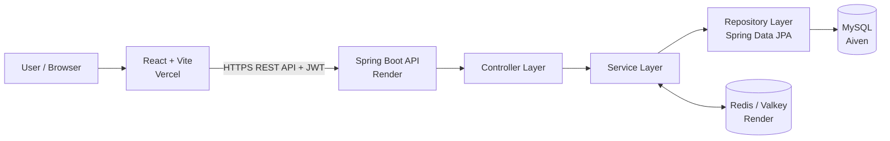

::: {align="center"}
# 🔗 URL Shortener

**Turn long links into short, shareable URLs.**

A full-stack URL shortener built with Java, Spring Boot, React, MySQL,
and Redis/Valkey.


[Features](#-features) · [Architecture](#️-architecture) · [Tech
Stack](#️-tech-stack) · [Run Locally](#-run-locally) ·
[API](#-api-overview)
:::

------------------------------------------------------------------------

## ✨ Features

-   **Short URLs** --- generate compact links from long URLs.
-   **Custom aliases** --- choose a memorable code for a short link.
-   **Authentication** --- user registration and login with JWT.
-   **URL management** --- view and manage your links.
-   **Click analytics** --- track link usage.
-   **Expiration** --- configure links to expire.
-   **Redis/Valkey caching** --- cache URL lookups to reduce repeated
    database reads.
-   **Rate limiting** --- limit repeated requests.
-   **Validation and error handling** --- handle invalid input and API
    errors consistently.
-   **Containerization** --- Docker-based deployment workflow.

> **Note:** A custom domain has not been configured yet, so generated
> short links use the deployed service URL.

## 🖼️ Screenshots

Add screenshots from your running application to the `images/` directory
and update these paths.

  Login                Dashboard
  -------------------- ------------------------
  `images/login.png`   `images/dashboard.png`

  Create a short URL        Analytics
  ------------------------- ------------------------
  `images/create-url.png`   `images/analytics.png`

```{=html}
<!-- When screenshots are added, replace the text above with:
<div align="center">
  
  
  
  
</div>
-->
```
## 🛠️ Tech Stack

  Area                        Technology
  --------------------------- ------------------------------------
  Backend                     Java, Spring Boot
  API                         REST
  Persistence                 Spring Data JPA / Hibernate, MySQL
  Authentication              Spring Security, JWT
  Caching and rate limiting   Redis-compatible Valkey
  Frontend                    React, Vite
  HTTP client                 Axios
  Deployment                  Docker, Render, Vercel, Aiven

## 🏗️ Architecture



### Request flow

**Create a short URL**

1.  The frontend sends the long URL and optional alias to the backend.
2.  The controller validates and forwards the request to the service
    layer.
3.  The service creates the short-code mapping and saves it through the
    repository.
4.  The API returns the generated short URL to the frontend.

**Redirect**

1.  A browser requests `/{shortCode}`.
2.  The backend checks the cache for the mapping.
3.  On a cache miss, the backend retrieves the mapping from MySQL and
    can cache it.
4.  The backend responds with an HTTP redirect to the original URL.

## 🚀 Run Locally

### Prerequisites

-   Java 17 or the Java version configured by the project
-   Maven (or the included Maven Wrapper)
-   Node.js and npm
-   MySQL
-   Redis/Valkey
-   Docker and Docker Compose (optional)

### 1. Clone the repository

``` bash
git clone https://github.com/Basavaraj8143/url-shortener.git
cd url-shortener
```

### 2. Configure the backend

Create a local environment configuration based on the variables
supported by your application. **Do not commit real passwords, JWT
secrets, or production credentials.**

``` env
DB_HOST=localhost
DB_PORT=3306
DB_NAME=url_shortener
DB_USERNAME=root
DB_PASSWORD=your_local_password

JWT_SECRET=replace_with_a_long_random_secret

REDIS_HOST=localhost
REDIS_PORT=6379

CORS_ALLOWED_ORIGINS=http://localhost:5173
```

Create the database in MySQL if it does not already exist:

``` sql
CREATE DATABASE url_shortener;
```

Start the backend from the directory containing the Maven project:

``` bash
./mvnw spring-boot:run
```

On Windows PowerShell:

``` powershell
.\mvnw.cmd spring-boot:run
```

The backend normally runs at `http://localhost:8080`, unless configured
otherwise.

### 3. Configure and start the frontend

``` bash
cd frontend
npm install
```

Create `frontend/.env`:

``` env
VITE_API_BASE_URL=http://localhost:8080
```

Start the Vite development server:

``` bash
npm run dev
```

The frontend normally runs at `http://localhost:5173`.

### 4. Docker Compose (optional)

If the repository's Docker Compose configuration includes the required
services, start them with:

``` bash
docker compose up --build
```

Stop the containers with:

``` bash
docker compose down
```

## 📡 API Overview

The exact request and response formats are defined by the backend
implementation. Common routes include:

  Method     Endpoint                 Purpose
  ---------- ------------------------ -------------------------------------------
  `POST`     `/register`              Register a user
  `POST`     `/login`                 Log in and obtain an authentication token
  `POST`     `/api/urls`              Create a short URL
  `GET`      `/api/urls`              List the authenticated user's URLs
  `GET`      `/api/urls/{id}/stats`   Retrieve URL analytics
  `DELETE`   `/api/urls/{id}`         Delete a URL
  `GET`      `/{shortCode}`           Redirect to the original URL

### Example: create a short URL

``` http
POST /api/urls
Content-Type: application/json
Authorization: Bearer <JWT>
```

``` json
{
  "longUrl": "https://example.com/a/very/long/path",
  "customAlias": "my-link",
  "expiryDays": 30
}
```

The `customAlias` and `expiryDays` fields are optional if supported by
the selected request model. Use the API's actual response to retrieve
the generated short URL.

## 🔐 Security

-   JWT-based authentication for protected endpoints.
-   Password hashing through the configured Spring Security password
    encoder.
-   Per-user access control for URL management.
-   CORS allowlist configured for permitted frontend origins.
-   Server-side request validation and centralized exception handling.
-   Secrets and database credentials supplied through environment
    variables.

## 🧠 What I Learned

-   Structuring a Spring Boot application with **Controller → Service →
    Repository** layers.
-   Using **JPA/Hibernate** for relational persistence.
-   Building and testing REST APIs.
-   Implementing JWT authentication and authorization.
-   Using Redis-compatible caching and rate limiting.
-   Connecting a React frontend to a deployed backend.
-   Configuring environment variables, CORS, Docker, and cloud services.

## 🌐 Deployment

-   **Frontend:** Vercel
-   **Backend:** Render
-   **MySQL:** Aiven
-   **Cache:** Render Key Value (Valkey)

Add the current live frontend and backend URLs here once you want them
displayed publicly:

-   **Live demo:** `YOUR_VERCEL_URL`
-   **Backend:** `YOUR_RENDER_URL`

## 📁 Project Structure

The exact folders may differ slightly depending on the current
repository layout.

``` text
url-shortener/
├── src/
│   └── main/
│       └── java/
│           └── .../
│               ├── config/
│               ├── controller/
│               ├── service/
│               ├── repository/
│               ├── entity/
│               ├── dto/
│               ├── exception/
│               └── security/
├── frontend/
├── Dockerfile
├── docker-compose.yml
├── pom.xml
└── README.md
```

## 👨‍💻 Author

**Basavaraj** · [GitHub](https://github.com/Basavaraj8143) ·
[Portfolio](https://basavaraj.tech)

If you find this project useful, feel free to ⭐ the repository or open
an issue.

------------------------------------------------------------------------

::: {align="center"}
**Built to learn by building. 🚀**
:::
