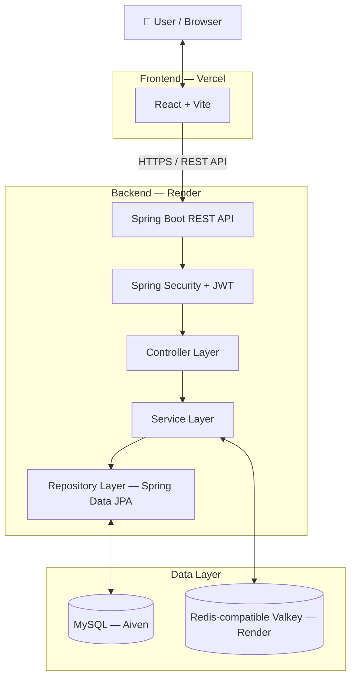

<div align="center">

# 🔗 URL Shortener

### Turn long links into short, shareable URLs.

A full-stack URL shortener built with Java, Spring Boot, React, MySQL, and Redis-compatible Valkey.

<p>
  
  
  
  
  
  
</p>

<p>
  
  
  
</p>

[Live Demo](https://frontend-wine-ten-8j0jpa0z.vercel.app) · [Backend API](https://url-shortener-n3st.onrender.com) · [Report an Issue](https://github.com/Basavaraj8143/url-shortener/issues)

</div>

---

## 📌 Overview

URL Shortener is a full-stack application that converts long URLs into compact, shareable links.

The project was built to explore Java backend development, Spring Boot's layered architecture, relational persistence, authentication, caching, and cloud deployment.

It combines a React frontend with a Spring Boot REST API, MySQL for persistent storage, and Redis-compatible Valkey for caching.

> **Note:** A custom domain has not been configured yet, so generated short links currently use the deployed service URL.

## ✨ Features

- 🔗 **URL Shortening** — Generate compact links from long URLs.
- 🎯 **Custom Aliases** — Create memorable short codes.
- 🔐 **JWT Authentication** — User registration, login, and protected endpoints.
- 📊 **Click Analytics** — Track usage of shortened URLs.
- ⏳ **URL Expiration** — Configure links to expire.
- 🗂️ **URL Management** — View and manage shortened links.
- ⚡ **Redis/Valkey Caching** — Reduce repeated database lookups.
- 🚦 **Rate Limiting** — Restrict repeated requests to help prevent abuse.
- ✅ **Input Validation** — Validate incoming requests.
- 🛡️ **Global Exception Handling** — Return consistent API errors.
- 🐳 **Docker Support** — Containerize the backend application.

## 🛠️ Tech Stack

### Backend

<p>
  
  
  
  
  
</p>

### Frontend

<p>
  
  
  
</p>

### Database & Caching

<p>
  
  
  
</p>

### DevOps & Deployment

<p>
  
  
  
  
</p>

## 🏗️ Architecture



### 🔄 How It Works

**1. Create a Short URL**

1. The frontend submits a long URL and an optional custom alias.
2. The controller receives the request and validates its input.
3. The service generates or processes the short code.
4. The repository saves the URL mapping in MySQL.
5. The API returns the shortened URL to the frontend.

**2. Redirect to the Original URL**

1. A browser requests `/{shortCode}`.
2. The backend checks Redis/Valkey for the mapping.
3. If the mapping is not cached, the application retrieves it from MySQL.
4. The mapping can be cached for future requests.
5. The backend responds with an HTTP redirect to the original URL.

**3. Authentication**

1. A user registers or logs in.
2. The backend validates the credentials.
3. The application issues a JWT after successful authentication.
4. The frontend sends the token in the `Authorization` header for protected requests.
5. Spring Security validates the token before allowing access.

## 🖼️ Screenshots

Add screenshots of your application to the `frontend/images/` directory.

Suggested screenshots:

| Login | Dashboard |
|---|---|
| `images/login.png` | `images/dashboard.png` |

| Create Short URL | Analytics |
|---|---|
| `images/create-url.png` | `images/analytics.png` |

When the screenshots are available, display them using:

```html
<p align="center">
  
  
</p>

<p align="center">
  
  
</p>
```

## 🚀 Run Locally

### Prerequisites

- Java 17 or the version configured by the project
- Maven or the included Maven Wrapper
- Node.js and npm
- MySQL
- Redis/Valkey
- Docker (optional)

### 1. Clone the Repository

```bash
git clone https://github.com/Basavaraj8143/url-shortener.git
cd url-shortener
```

### 2. Create the Database

Open MySQL and execute:

```sql
CREATE DATABASE url_shortener;
```

### 3. Configure the Backend

Configure the environment variables supported by the application.

Example local configuration:

```properties
DB_HOST=localhost
DB_PORT=3306
DB_NAME=url_shortener
DB_USERNAME=root
DB_PASSWORD=your_local_password

JWT_SECRET=replace_with_a_long_random_secret

REDIS_HOST=localhost
REDIS_PORT=6379

CORS_ALLOWED_ORIGINS=http://localhost:5173
```

These are environment-variable examples. Set them in your IDE's run configuration or your local environment.

**Never commit production passwords, database credentials, or JWT secrets.**

Start the backend from the directory containing `pom.xml`.

**Windows PowerShell:**

```powershell
.\mvnw.cmd spring-boot:run
```

**macOS/Linux:**

```bash
./mvnw spring-boot:run
```

Alternatively, if Maven is installed:

```bash
mvn spring-boot:run
```

The backend normally runs at:

`http://localhost:8080`

### 4. Configure the Frontend

```bash
cd frontend
npm install
```

Create `frontend/.env`:

```env
VITE_API_BASE_URL=http://localhost:8080
```

Make sure the environment variable name matches the one used in the frontend API client.

Start the frontend:

```bash
npm run dev
```

The Vite development server normally runs at:

`http://localhost:5173`

### 5. Run with Docker (Optional)

If your Docker Compose configuration defines the required services, run:

```bash
docker compose up --build
```

Stop the containers:

```bash
docker compose down
```

Check your existing Docker Compose configuration to confirm which services it starts.

## 📡 API Overview

The following table describes the intended API surface. Verify the exact paths and request formats against the current backend implementation.

| Method | Endpoint | Description |
|---|---|---|
| `POST` | `/register` | Register a user |
| `POST` | `/login` | Authenticate and obtain a JWT |
| `POST` | `/api/urls` | Create a shortened URL |
| `GET` | `/api/urls` | List the authenticated user's URLs |
| `GET` | `/api/urls/{id}/stats` | Retrieve URL analytics |
| `DELETE` | `/api/urls/{id}` | Delete a URL |
| `GET` | `/{shortCode}` | Redirect to the original URL |

Authentication routes may differ depending on your controller mappings.

### Example: Create a Short URL

```http
POST /api/urls
Content-Type: application/json
Authorization: Bearer <JWT>
```

Example request:

```json
{
  "longUrl": "https://example.com/a/very/long/path",
  "customAlias": "my-link",
  "expiryDays": 30
}
```

The `customAlias` and `expiryDays` fields are illustrative. Use the exact field names supported by your request DTO.

## 🔐 Security

- JWT-based authentication.
- Password hashing through the configured Spring Security password encoder.
- Authorization for protected endpoints.
- CORS configuration for permitted frontend origins.
- Server-side input validation.
- Centralized exception handling.
- Environment variables for sensitive configuration.

## ⚡ Performance & Reliability

- **Caching:** Redis/Valkey can reduce repeated database lookups for frequently accessed URLs.
- **Rate Limiting:** Helps restrict excessive requests.
- **Persistence:** MySQL stores URL mappings and metadata.
- **Database Access:** Spring Data JPA and Hibernate simplify relational persistence.
- **Containerization:** Docker provides a consistent backend build and runtime environment.

## 🌐 Deployment

| Component | Platform |
|---|---|
| Frontend | Vercel |
| Backend API | Render |
| MySQL Database | Aiven |
| Cache / Key-Value Store | Render Key Value (Valkey) |

### Production Configuration

Configure the following variable in Vercel:

```env
VITE_API_BASE_URL=https://YOUR-RENDER-SERVICE.onrender.com
```

Replace the placeholder with the actual backend URL.

The backend must allow the deployed frontend origin through its CORS configuration.

> Never put database passwords, private API keys, or JWT secrets in frontend environment variables.

### 🔗 Project Links

<p>
  <a href="https://github.com/Basavaraj8143/url-shortener">
    
  </a>
  <a href="https://url-shortener-n3st.onrender.com">
    
  </a>
  <a href="https://frontend-wine-ten-8j0jpa0z.vercel.app">
    
  </a>
</p>

## 📁 Project Structure

The structure below is representative. Adjust it to match the actual repository.

```text
url-shortener/
├── src/
│   └── main/
│       ├── java/
│       │   └── .../
│       │       ├── config/
│       │       ├── controller/
│       │       ├── service/
│       │       ├── repository/
│       │       ├── entity/
│       │       ├── dto/
│       │       ├── exception/
│       │       └── security/
│       └── resources/
│           └── application.properties
├── frontend/
├── Dockerfile
├── docker-compose.yml
├── pom.xml
└── README.md
```

## 📚 What I Learned

- Structuring Spring Boot applications using Controller → Service → Repository layers.
- Using Spring Data JPA and Hibernate for relational persistence.
- Designing and testing REST APIs.
- Implementing JWT authentication and Spring Security.
- Working with MySQL and Redis-compatible caching.
- Connecting a React frontend to a Spring Boot backend.
- Configuring CORS and environment variables.
- Containerizing and deploying an application using Docker and cloud platforms.

## 👨‍💻 Author

**Basavaraj**

- GitHub: [Basavaraj8143](https://github.com/Basavaraj8143)
- Portfolio: [basavaraj.tech](https://basavaraj.tech)

If you find this project useful, feel free to ⭐ the repository or open an issue.

---

<div align="center">

**Built to learn by building. 🚀**

</div>